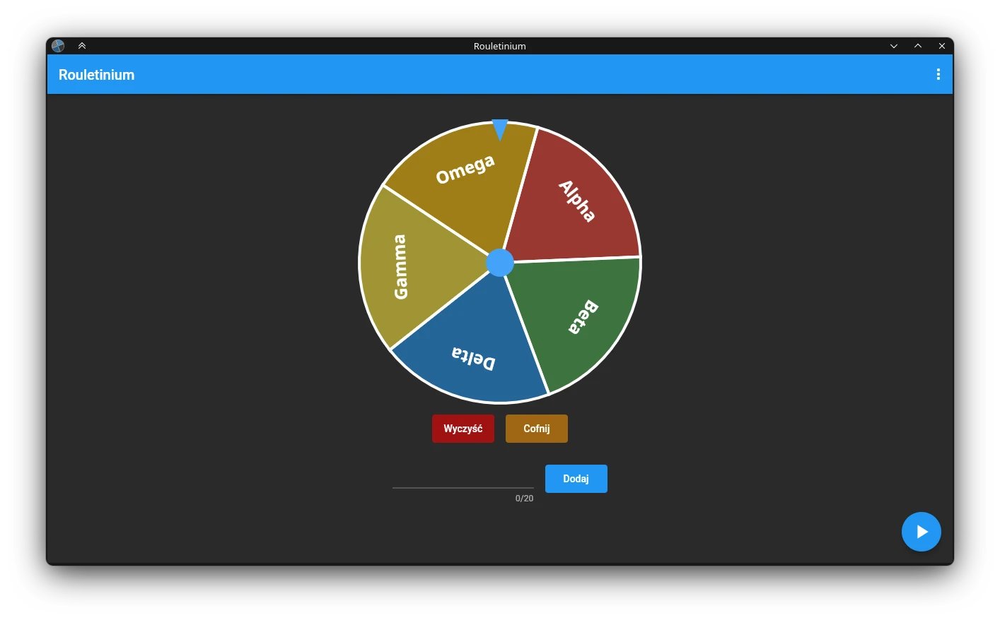

A simple roulette application written in [Flutter](https://flutter.dev/) using [roulette](https://pub.dev/packages/roulette) package available in pub.dev

Application is designed to run under Android, Linux, Windows and Web

### Application is still under development so expect some bugs

# Instalation for Windows, Linux and Android
You can download already builded versions from [Releases](https://gitlab.com/Skeletonek/Rouletinium/-/releases) section

# Web version
You can also run the web version available from [here](https://rouletinium.skeletonek.com/)

Please do note: The web version of Rouletinium app is based on the newest changes pushed to the main branch of this repository. Due to this, **application can behave unexpectedly.**

# Building
If you want to build Rouletinium by yourself you will need to download [Flutter SDK](https://docs.flutter.dev/get-started/install).\
As for now, it is recommended to download Flutter 3.7.10. Also make sure you have a Dart SDK in version newer than 2.17.1.\
For specific building instructions please refer to [Flutter Documentation](https://docs.flutter.dev/testing/build-modes).
